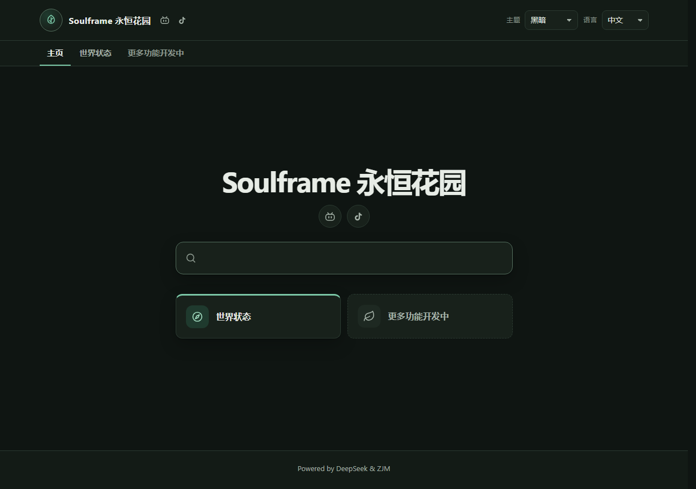

# Soulframe Eternium Garden / Soulframe 永恒花园



一个双语、离线可用的 Soulframe 实用工具合集。当前版本 **v0.1.0**，完成 **世界状态** 页：密德拉的昼夜时间、天气、泽尼斯的每日商品，以及受祝福的会面。

中文版页面名称使用 **Soulframe 永恒花园**，英文版保持 **Soulframe Eternium Garden**。

- 中文 / English 切换，语言选择保存在浏览器；也可用 `?lang=zh` / `?lang=en` 打开指定语言。
- 明亮 / 黑暗 / 跟随系统三种主题；也可用 `?theme=light` / `?theme=dark` 打开指定主题。
- 原生 HTML / CSS / JavaScript，无框架、无外部字体、无运行时依赖。
- 直接双击 `index.html` 即可使用；也可以放在任意静态托管上。
- 不请求游戏或第三方 API，断网也能推算世界状态。

## 快速开始

### 方式 A：直接打开

双击根目录的 `index.html`。所有数据、脚本和头像都是本地文件，不需要服务器。

### 方式 B：本地预览服务器

要求 Node.js 20 或更高版本。

```bash
npm start
# http://127.0.0.1:4180/
```

可用 `PORT` 环境变量改端口，例如 `PORT=8080 npm start`。

### 测试

```bash
npm test
```

测试使用 Node 内置 test runner，不需要安装依赖。

## 发布到 GitHub Pages

仓库根目录就是静态站点，不需要构建步骤：

1. 把仓库推送到 GitHub。
2. 打开 **Settings → Pages**。
3. **Build and deployment** 选择 **Deploy from a branch**。
4. 选择 `main` 分支和 `/ (root)` 目录，保存。
5. 等待 Pages 生成 `https://<用户名>.github.io/soulframe-eternium-garden/`。

根目录的 `.nojekyll` 已关闭 Jekyll 处理。页面使用 hash 路由和相对路径，部署在项目子路径下也能正常工作。

> GitHub Pages 只能提供静态文件；本项目本来就不依赖服务器，因此不存在 API 或 CORS 限制。

## 已实现

### 主页

居中显示站点标题、B 站 / 抖音图标和搜索框；搜索按名称、描述与中英文关键词过滤下方卡片，Enter 打开第一个结果，Esc 清空。卡片只保留图标和标题，仅展示「世界状态」与「更多功能开发中」两个入口。页脚居中显示「Powered by DeepSeek & ZJM」。

### 世界状态

- **世界时间**：游戏内时钟与官方阶段提示「萨菲茵闪耀 / 莫拉升起 / 伊瑞迪斯苏醒」，下方三格显示萨菲茵 / 莫拉 / 伊瑞迪斯。一个游戏日约 48 分钟。
- **天气**：当前天气、层级、结束时间与倒计时、天气影响，以及接下来 4 段天气预报。
- **泽尼斯的商品**：每日 4 把武器（1 弓、2 近战、1 法器）、弧光币价格、重置倒计时与明日预览。
- **受祝福的会面**：今日角色、下次回归天数、未来 7 天排期、重置倒计时，以及祝福与重置规则说明。会面头像使用游戏内官方资源：7 位先祖来自 Soulframe 缓存的官方立绘 / 半身像；先知戴尔因当前版本没有官方头像，使用项目作者提供的壁纸裁切（头颈特写），并做透明边缘柔化。

所有内容都是 UTC 时间的纯函数，每日 00:00 UTC 切换。页面每秒刷新时钟与倒计时，跨日时自动重绘当日数据。

### 自定义模块排序

世界状态页提供「自定义排序」：用上移 / 下移按钮调整四个模块的顺序，顺序保存在本机浏览器（`sf-eg-world-layout`），可一键恢复默认。排序后会重新执行补位布局，DOM 顺序、视觉顺序和键盘 Tab 顺序保持一致。

### 自适应补位布局

世界状态的四个模块使用 12 列网格 + 8px 行单位的两列补位布局，而不是固定行：

- 在 4/8、5/7、6/6 三种列宽下分别测量四个模块的真实高度；
- 选择两列高度最平衡、最省纵向空间的方案；
- 用显式 `grid-row` 让同列下一张卡片紧跟在上一张下面，消除同排短模块下方的大块空白；
- 窗口缩放、字体加载、天气刷新、阶段切换和「明日预览」展开时重新计算；
- 900px 以下自动变为单列，脚本不介入，保留纯 CSS 回退。

### 更多功能

配装模拟、材料与配方、活动日历三个预留方向，暂未实装；主页和顶栏只保留「更多功能开发中」占位，不提供无效入口。

## 数据与算法

算法来自 Soulframe Wiki 的客户端逆向模块，并已做本地化与边界处理：

| 系统 | 来源 | 说明 |
|---|---|---|
| 昼夜时钟 | `MediaWiki:Gadget-MidrathSky.js` | 锚点 2014-02-10，速率 0.00833 游戏小时 / 真实秒 |
| 天气 | 同上（build 2026-09-24） | 2D simplex + float32 舍入 + 原生 preset 哈希 |
| 泽尼斯商品 | `Module:ZenithShop` | 64 位 LCG + 三个池共享状态的 Fisher–Yates 洗牌 |
| 受祝福的会面 | `Module:MeetingRotationV2` | 64 位 LCG + 加权抽样，2026-07-23 起有数据 |

关键实现：

- 64 位 LCG 用两个 32 位半字实现，不依赖 `BigInt`，兼容面更广。
- 天气保留 `Math.fround` 的每一步舍入、`nativeFloor` 与 `Math.imul` 顺序。
- 时间全部按 UTC 计算，展示时再转换成浏览器本地时区。
- 不请求任何游戏或第三方 API；断网也能用。

### 与实时 Wiki 的核对

2026-11-25 00:45 UTC 用浏览器读取 wiki 的 `mw.midrathSky` 运行时，与本地实现在同一 `serverNowMs` 上逐项比对：

- `clockAt` 的 turns / hour / phase / remaining 完全一致；
- `weatherAt` 返回的 preset id 完全一致；
- `forecast` 四段天气的起止时间完全一致。

因此当前版本的时间与天气算法仍与 wiki 实时显示一致。

### 头像资源

会面头像放在 `assets/img/ancestors/`，每张都有 128 / 256 两档：

- 加伦·鲁德、布隆弥、奥伦加、泽尼斯、图瓦卡恩、维米尼娅、奥利克：从 Soulframe `Cache.Windows` 的 `Texture` 包提取的官方立绘 / 半身像；
- 先知戴尔：当前版本没有官方头像，使用项目作者提供的壁纸裁切为头颈特写，并做透明边缘柔化；
- 页面按 `srcset` 自动选择 128 或 256，显示区域为 52×52。

## 本地化

游戏名词取自 `ee-localization` 提取的官方简中文本（`Soulframe_zh_en.tsv`），由 `scripts/build-data.py` 生成 `assets/data/game.js`：

```bash
python scripts/build-data.py --tsv /path/to/Soulframe_zh_en.tsv
```

- 武器名、角色名优先使用官方简中；中文界面同时显示英文原名。
- `Nazilk-Urytes-III` 在当前官方简中文本中没有条目，界面保留英文并标「待译」，不自行音译。

## 已知限制

- **受祝福的会面的 3 个具体祝福无法推算**：由服务器随机，重新登录可刷新选项。工具只显示每日角色。
- **淬炼属性（Temper）无法推算**：泽尼斯武器的 Temper 由游戏另行随机。
- **Nazilk-Urytes-III 缺少价格**：wiki 的 `Module:Data/Vendors` 尚无该武器的价格行，界面显示「价格待补」。
- **时间以设备时钟为准**：设备时间偏差会直接影响推算结果。
- **天气名称为社区命名**：游戏内只暴露 preset id，`Clear Skies` 等显示名来自 wiki。
- 会面轮换在 2026-07-23 之前没有可推算的数据。

## 指南核对

对照 `Soulframe世界状态推算_复刻指南.md` 与 wiki 源码 / 实机 API，确认并修正了以下问题：

1. **近战池是 43 把，不是 42 把**。指南中的列表实际有 43 项（`Module:ZenithShop` 同样为 43 项），注释里的「42 把」是错的。
2. **Python 参考实现的锚点日号差 1**。指南写 `if dayNum < 20656` 并注释为 2026-07-23，但 2026-07-23 的 UTC day number 是 **20657**；该写法会把 07-23 判为「无数据」。JS 版的 `Date.UTC(2026, 6, 23) / 86400000` 是正确的。
3. **天气代码片段不完整**。指南只给了 `simplex`，缺少 `gradient`、`corner`、`perm` 与 256 项 `PERM` 表；这些都在 `Gadget-MidrathSky.js` 中，已按原文移植。
4. **官方 API 不是完全空壳**。`https://api.soulframe.com/cdn/worldState.php` 仍返回 `Time`、`Conquests`、`Descents`、`WorldSeed` 等字段；但天气、泽尼斯商品、会面角色确实不在其中，所以「本地推算」的结论不变。本项目不依赖该 API。
5. **Nazilk-Urytes-III 没有价格数据**。指南只提到价格来自 `Module:Data/Vendors`，但该表没有这把武器的行；工具按缺失处理。

## 工程结构

```text
soulframe-eternium-garden/
  index.html
  .nojekyll
  assets/
    css/site.css
    data/game.js          # 由 build-data.py 生成
    data/ui.js            # 中英文界面文案
    img/ancestors/        # 8 位会面角色头像，128 / 256
    img/readme-home.png   # README 截图
    js/core.js            # 时间 / 天气 / 商店 / 会面算法
    js/app.js             # 路由、渲染、主题、语言、实时刷新
  scripts/
    build-data.py         # 从官方本地化表生成 game.js
    serve.js              # 零依赖静态服务器
  test/
    core.test.js          # 算法锚点与数据完整性
    ui.test.js            # 中英文字典与页面 key 对齐
    release.test.js       # 发布资源、链接与版本检查
  .github/workflows/test.yml
  CHANGELOG.md
  LICENSE
  NOTICE.md
  package.json
  README.md
```

## 开发

```bash
npm start   # 本地预览
npm test    # 运行测试
```

`scripts/build-data.py` 只在更新官方名词 / 价格 / 会面权重时需要运行。`scripts/serve.js` 没有第三方依赖，只用于本地预览。

## 浏览器支持

面向现代常青浏览器（Chrome / Edge / Firefox / Safari 的近期版本），桌面与移动端均可用。实现使用：

- 经典 `<script>`，不依赖 ES Module，因此 `file://` 也能直接打开；
- CSS 变量、Grid、Flexbox、`clamp()`，并提供明暗两套 token；
- `Math.fround` / `Math.trunc` / `Math.imul` 均带兼容回退；
- 不加载外部字体、图片或 CDN 资源。

## 版权与免责声明

本项目是非官方、非商业粉丝工具，与 Digital Extremes 无关，也未获得其认可或赞助。Soulframe、Warframe、Digital Extremes 及相关名称、游戏数据、游戏资产归其各自权利人所有。

部分会面头像是从本机 Soulframe 游戏缓存提取的官方资源；先知戴尔头像来自项目作者提供的壁纸。它们仅用于非商业粉丝工具展示，**不包含在代码许可证范围内**。完整说明见 [NOTICE.md](NOTICE.md)。

## 许可证

本项目源代码采用 **MIT License**，完整文本见 [LICENSE](LICENSE)。你可以自由使用、修改、分发和商用代码，但需要保留版权与许可证声明。

MIT 仅覆盖源代码；Soulframe 游戏名称、数据、头像和其他游戏资产仍归其各自权利人所有，不在 MIT 授权范围内。详见 [NOTICE.md](NOTICE.md)。

## 版本

当前版本 **0.1.0**。变更记录见 [CHANGELOG.md](CHANGELOG.md)。

---

## English summary

Soulframe Eternium Garden is a bilingual, offline-friendly Soulframe utility hub. Version 0.1.0 ships a **World State** page with Midrath's clock, weather and forecast, Zenith's daily wares, and the Blessed Meeting. Everything is derived from UTC time with no network requests.

The home page is a centered title, social links, search box, and two tool entries. The four world modules use a measured two-column masonry that tries 4/8, 5/7, and 6/6 column splits, balances column heights, and stacks each column with explicit grid rows so shorter modules do not leave holes. Module order can be changed and is stored locally.

Open `index.html` directly, or run `npm start` and visit <http://127.0.0.1:4180/>. The repository root is a static GitHub Pages site; no build step is required.

Game names use the official Simplified Chinese localization extracted with `ee-localization`. The prediction algorithms mirror the Soulframe Wiki's client-reverse-engineered modules and were checked against the live wiki clock, weather preset and forecast boundaries at the same server timestamp.

Known gaps: the meeting's three Graces and Zenith Tempers are server-random; `Nazilk-Urytes-III` has no localized name or price entry; times depend on the device clock. The source code is MIT-licensed; game assets are excluded. See [NOTICE.md](NOTICE.md) for asset attribution and licensing.
